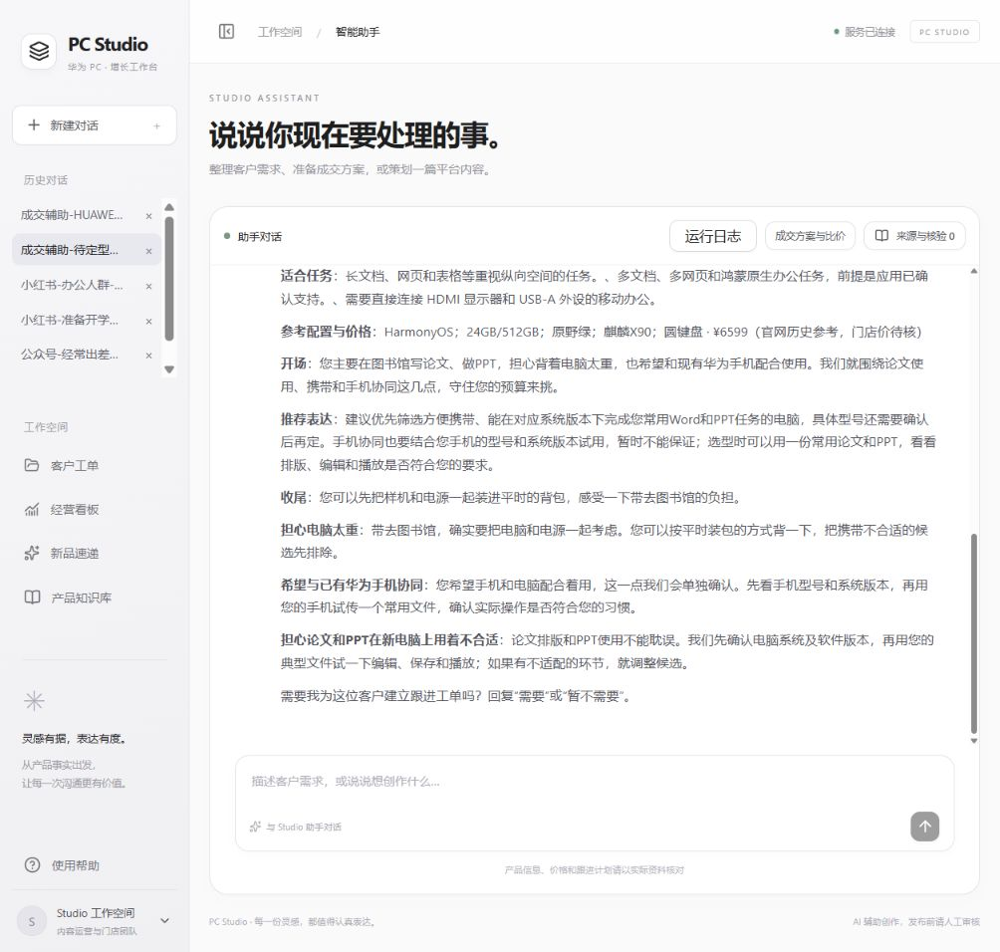
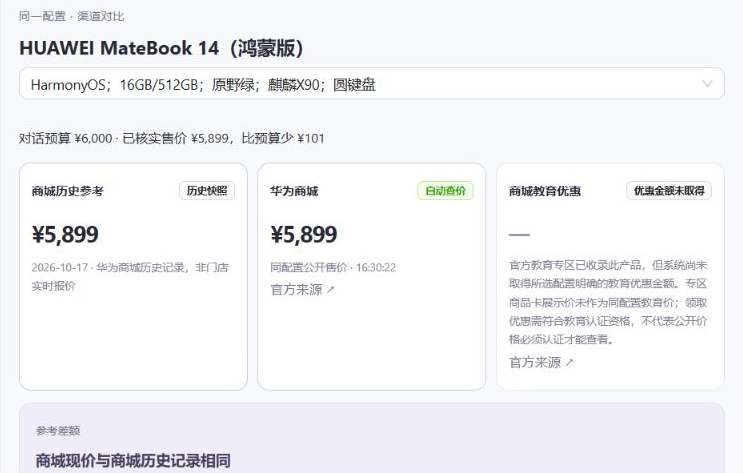

<div align="center">

# Huawei PC marketing agent

### 面向华为门店员工的 AI 营销工作台

**从一句想法，到有产品依据的图文，再到顾客跟进。**

[项目说明书](项目说明书.pdf) · [可编辑 Word](项目说明书.docx) · [功能与实现详解](docs/作品说明书.md) · [快速启动](#快速启动)

</div>



## 它能帮门店员工做什么

“想给经常出差的人推荐一台电脑，但还没想好型号。”

这已经足够开始。PC Studio 从对话中提取用途和人群，推荐有依据的产品，帮助员工确认型号与平台，再生成正文、配图和可回查的产品引用。顾客开始咨询后，同一个入口还可以准备比价方案、异议回应和后续跟进草稿。

| 员工要做的事 | PC Studio 提供的帮助 |
| --- | --- |
| 不知道怎么开始写 | 提取已知信息，只追问关键缺口；不确定时给候选和理由 |
| 为不同平台准备内容 | 按小红书、公众号、朋友圈等平台的 Skills 策划和写作 |
| 给软文配图 | 主 Agent 交付配图计划，生图子 Agent 结合官方素材生成场景图 |
| 查产品、核对参数 | 新品速递与知识库集中查看；正文引用角标直达知识条目 |
| 回应顾客并持续跟进 | 同配置比价、沟通话术、第 1／3／7 天草稿，按需建工单 |


## 五个让工作更顺手的设计

### 01　不用先填完一张表

有明确型号，就围绕它创作；只有使用场景，就先推荐产品，展示“使用习惯—产品特性—推荐理由”，再让员工选择。模型负责规划下一步追问，已知信息与已确认选择进入会话状态，支持继续修改。

> **试一试：** 我是华为门店员工，想写一篇给经常出差的咨询顾问看的小红书，推荐适合改 PPT、开会、随身携带的华为电脑。型号还没确定，先帮我选。

### 02　平台 Skills 从选题开始区分写法

同一个产品卖点，在小红书可以从生活动作切入，在公众号则需要更完整的解释。平台规则覆盖选题、标题、段落节奏、互动结尾和标签，并进入策划、写作与审稿环节。

| 平台 | 表达方向 |
| --- | --- |
| 小红书 | 先找到可独立成立的生活经验或姿态，让产品承接读者的偏好；短段落和自然 emoji 服务于分享感 |
| 微信公众号 | 先提出可讨论的判断，围绕理由和证据推进论点；产品作为判断的具体例子 |
| 朋友圈 | 简洁、熟悉的门店沟通语气，便于承接咨询 |
| 微博／抖音／B站 | 按平台策略调整信息密度、开头与内容结构 |

产品事实通过引用支撑。准确性规则在生成和核验时执行，正文尽量避免重复堆叠“资料未提供”等防御性说明。

创作前的灵感流程会读取需求、搜索公开来源、核对发布时间，随后按平台、人群和产品筛选几个切入点，等待员工选择。**事件话题**需直接关联产品或目标人群的真实需求；**表达玩法**可从美食等其他场景借用自然贴切的句式，不要求原话题提及电脑。来源日期可核实、传播规模未知的标为「近期表达参考」；日期未知的标为「表达参考（时间待核实）」；只有可核验的传播证据才标为「热门梗」。选题来源不充当产品事实依据。详见[灵感工作流](docs/platform-inspiration-workflow.md)。

### 03　生图子 Agent 把配图一起完成

主 Agent 将产品、受众、平台与视觉计划交给独立图片流程。子 Agent 处理官方素材、调用图片模型、保存产物并回传结果，支持多张场景图；具体数量受任务计划与后端上限控制。

- **参考编辑：** 以同型号官方图为参考，生成不同背景与构图。
- **背景与主体合成：** 生成场景背景，准备透明主体或抠图，再完成合成。
- **失败回退：** 单图失败或超时时保留告警，按已有逻辑回退官方素材。

下面是项目保存的真实运行产物，均为 **AI 创意配图，非实拍**。

<table>
  <tr>
    <td width="33%"></td>
    <td width="33%"></td>
    <td width="33%"></td>
  </tr>
  <tr>
    <td><b>出差办公 · 小红书</b><br>MateBook 14 酷睿 Ultra<br>从装包与移动办公切入</td>
    <td><b>出差办公 · 公众号</b><br>MateBook D 14 2024<br>展开携带、阅读与会议连接</td>
    <td><b>开学购机 · 小红书</b><br>MateBook Pro S<br>围绕学习和往返教室组织内容</td>
  </tr>
</table>

完整节选、来源和改进点见[项目说明书](docs/作品说明书.md)。历史案例使用不同型号，不作为平台风格的受控对照实验。

### 04　创作、学产品、查依据在同一工作台

历史对话保留创作上下文，工作空间集中放置客户工单、经营看板、新品速递和产品知识库。员工先了解产品定位，再开始创作；发现正文参数需要确认时，点击引用角标即可打开对应知识条目。

**产品资料 → 检索证据 → 正文引用角标 → 对应知识库条目**，让创作与产品学习连在一起。静态事实来自本地华为 PC v7 知识库，运行时不依赖 ima 云检索。

成稿工具栏提供「发布预览」，按小红书、公众号等平台模拟图文阅读效果，便于发布前检查标题、正文和图片位置。预览是本地模拟，实际排版以目标平台为准。

### 05　顾客问“网上是不是更便宜”，有工具接住

成交助手结合预算、用途、软件需求和顾虑准备推荐与回应；产品选定后进入同配置比价，再生成第 1／3／7 天跟进草稿。



*2026 年 10 月 23 日本地演示截图。查询时该配置公开售价为 ¥5,899，价格随时间变化。*

- **自动查询官方渠道：** 打开面板或切换配置，查询 VMall 商品页和教育专区，核对系统、内存、存储等配置。
- **价格来源分开展示：** 商城历史参考、当前公开售价、教育优惠和门店实际报价各有状态；未取得的金额不当作已确认优惠。
- **优惠按条件核算：** 国补依资格和政策条件试算；门店报价可录入后进一步比较。
- **跟进围绕实际阻碍：** 第 1 天补齐关键条件，第 3 天推进配置与报价，第 7 天按购买状态收口；草稿随顾客情况生成。

草稿由员工审核发送。需要持续跟进时，再征得联系意愿、补齐信息并建立工单。

## 自研 Agent 如何支撑这些体验

PC Studio 自研面向门店业务的编排与运行环境，将需求理解、知识检索、平台 Skills、生图子 Agent、核验和成交工具连接起来。

| 模块 | 工程职责 |
| --- | --- |
| 主 Agent | 识别意图、分析信息缺口、规划追问、调用能力并组织结果 |
| 会话与任务管理 | 保存消息与状态，管理多会话作业和阶段进度 |
| 知识与价格工具 | 提供产品证据、官方素材、同配置公开查询与优惠核算 |
| 平台 Skills | 将各平台表达规范注入策划、写作和审稿 |
| 生图子 Agent | 承接配图计划，执行参考编辑或合成并回传图片 |
| 核验与追踪 | 检查结构、事实与引用，记录失败阶段和请求标识 |

自研范围是上述业务 Agent 与 harness；底层文本和图片模型通过后端服务调用。聊天记录持久化不等于模型已经自动学习了长期经验。

## 快速启动

建议使用 Node.js 22。在项目根目录执行：

```powershell
npm --prefix services/api install
npm --prefix apps/web install
Copy-Item .env.example .env
```

在根目录 `.env` 配置后端模型服务：

```dotenv
LLM_BASE_URL=<兼容接口地址>
LLM_API_KEY=<文本模型密钥>
LLM_MODEL=<服务商实际支持的模型名称>
IMAGE_PROVIDER=openai-next
IMAGE_BASE_URL=https://api.openai-next.com/v1/images/generations
CREDIT_MEDIA_API_KEY=<图片模型密钥>
IMAGE_MODEL=gpt-image-2
IMAGE_MAX_IMAGES=3
```

完整参数见 [.env.example](.env.example) 和[生图接入说明](docs/image-agent-integration.md)。凭证仅配置在后端。

分别在两个终端启动：

```powershell
# 终端 1：API
node scripts/start-api.cjs
```

```powershell
# 终端 2：Web
npm --prefix apps/web run dev -- --host 127.0.0.1 --port 5173
```

打开 **http://127.0.0.1:5173/**。公开查价需要可用的 Edge／Chrome；其他环境可通过 `PRICE_BROWSER_EXECUTABLE` 指定浏览器路径。

## 演示从这两句话开始

**内容创作：**

> 给准备开学的大学新生做一篇小红书图文，重点是带着电脑上课和看课件。型号还没确定，先推荐并告诉我理由；我选好后再生成正文和配图。

**成交辅助：**

> 我是华为门店销售。顾客预算 6000—8000 元，经常出差改 PPT、处理 Excel、开会议，担心公司插件兼容，也想比较网上价格。请推荐合适产品，准备现场回应和 1／3／7 天跟进草稿。未经核实的兼容性和优惠不要承诺。

## 文档与目录

| 文档 | 内容 |
| --- | --- |
| [说明书 PDF](项目说明书.pdf)／[Word](项目说明书.docx) | 功能概括、五项优势、真实案例和赛题回应 |
| [作品说明书](docs/作品说明书.md) | 在仓库直接阅读的产品说明 |
| [接口约束](接口约束.md) | 对外 API 与字段约定 |
| [前端交互规范](docs/frontend-interaction-spec.md) | 工作台交互与集成约定 |
| [生图子 Agent 接入](docs/image-agent-integration.md) | 接口、素材、服务商与回退边界 |
| [平台写法试跑样例](docs/demo/platform-editorial-examples-2026-10-26.md) | 小红书、公众号与“不烧心”表达改编；标明事实和来源 |
| [公开渠道查价改动](docs/changes/2026-10-23-public-channel-prices.md) | 官方查询与优惠核算说明 |

```text
apps/web/              统一对话工作台
services/api/          主 Agent、工具服务与生图子 Agent
packages/shared/       共享类型和契约
tests/                 业务与接口验证
docs/                  产品说明、演示图片与接入文档
scripts/               启动和验证脚本
```

## 当前边界

仓库保留运行所需的本地知识库目录和当前说明书。知识库原始压缩包、旧版文档、内部评审稿与客户工单数据不进入版本控制；工单由服务端在本地创建，模型密钥只放在本地 `.env` 或部署环境变量中。

这是持续迭代的黑客松项目。平台文风与长期上下文质量仍需系统评测；图片编辑可能改变产品细节，发布前需人工核验。公开售价有查询时间，教育优惠、国补和成交价受实际条件影响。经营看板汇总系统内记录，尚不等于外部平台传播或成交归因。

项目希望回应主办方的三个核心诉求：**产品对应真实、内容吸引人、操作足够简单，让门店员工愿意创作。** 当前展示以真实产物和功能验证为依据，不宣称已验证传播或成交提升。
