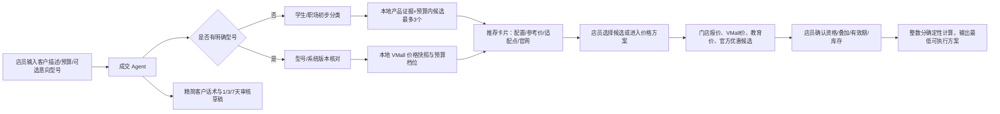

# 成交助手 Demo 最终变更说明

日期：2026-10-22
基线：`4643ece053ed0eaa40af0129c31e0115df580bb7`
用途：门店销售演示。真实上线前必须替换为真实门店报价、库存、活动资格和人工确认流程。

## 1. 当前实际链路

## 2. 纳入提交的修改

### Skill 与交互规则

- `skills/customer-conversion/SKILL.md`：规定先理解用途和预算，再给最多三个候选；客户选定后才进入价格比较；客户话术不展示内部证据、政策适用范围、模型思考或未确认金额。学生和职场是当前可用的初步分类。
- `skills/customer-conversion/references/theory-to-dialogue.md`：保存精细化可能性模型、选择过载研究和前景理论的培训映射。它不在运行时注入，不构成成交保证。
- `services/api/src/clients/llmClient.cjs`：运行时加载 Skill，并禁止模型在话术字段输出价格、预算、折扣或补贴金额；金额由确定性价格模块渲染。对 `o4-mini` 省略不兼容的 `temperature` 参数。

### 推荐、预算与价格参考

- `services/api/src/agent/customerAgent.cjs`：无型号时按场景推荐；有预算时只保留预算内已知价格并标出最高价档；意向型号超预算时给出最低参考价、差额和替代候选；模型话术不合规时降级为有来源的产品卡和安全文本；跟进日期只允许 1/3/7 天。
- `services/api/src/services/scenarioProductSearch.cjs`：增加学生、论文、便携、办公、设备协同匹配和学生/职场分类；没有游戏演示入口，自由输入游戏需求时仅保留明确有适配证据的产品；保留现有营销任务对该共享搜索服务的调用，因此推荐排序可能变化。
- `services/api/src/services/priceSolutionService.cjs`：读取实际知识库价格卡，不再虚构“四档”；处理华为/HUAWEI和系统版本名称；没有价格记录时明确不可用；支持最低价、预算内最高档、差额和配置状态。
- `apps/web/src/components/ProductRecommendations.jsx`、`apps/web/src/App.jsx`、`apps/web/src/styles.css`：以横向推荐卡呈现产品、配置、参考价、适配点、图片和官网链接；内部运行记录和证据收进折叠面板。

### 门店/线上价格与优惠演示

- `apps/web/src/components/StorePricePlanner.jsx`：真实门店录入入口，要求配置、报价来源、有效期、库存和店员确认；不自动连接 POS。
- `apps/web/src/components/DemoStorePricePlanner.jsx`：演示入口读取知识库基准，比较华为商城价格、VMall 教育价和官方国补规则；演示值保留在当前页面，不写数据库。
- `apps/web/src/components/OfferRuleLookup.jsx`：查询官方优惠候选，逐项确认适用范围和叠加关系；未确认不进入最终价格。
- `apps/web/src/lib/storePricePlan.mjs`、`apps/web/src/lib/demoStorePlan.mjs`：使用整数分计算，处理门槛、封顶、互斥、有效期、线上/门店渠道和旧机回收单列。
- `services/api/src/services/channelPriceService.cjs`、`services/api/src/services/storeOfferRules.cjs`、`services/api/src/server.cjs`：新增渠道价格和官方优惠查询接口，仅允许 HTTPS 官方域名，联网失败不编造价格。
- `shared/pcSubsidy2026.json`：记录已核验的 2026 家电国补规则：符合条件的一级能效电脑按实际销售价 15% 补贴、每件最高 1500 元；资格、能效、当地实施、SKU和叠加关系默认待人工确认。它不是固定 500 元演示规则。
- `Dockerfile`：复制 `shared/` 到前端构建阶段及运行镜像，复制 `skills/` 到运行镜像，确保容器与本地运行读取同一政策和 Skill 文件。

## 3. 为什么不能只添加 Skill

Skill 只能约束模型表达，不能可靠完成预算过滤、同型号版本消歧、价格快照读取、官方域名限制、优惠叠加计算、异常降级、前端隐藏内部证据或容器资源打包。因此上述后端、前端和确定性计算改动是完成 Demo 所需的代码范围；成交助手自身没有新增依赖、数据库表或自动发送能力。随后合并的图片生成分支新增 `sharp` 依赖，见第 7 节。

## 4. 明确排除的内容

成交助手提交不包含 `research/`、`docs/testing/`、`docs/superpowers/`、`tests/fixtures/`、`docs/仓库代码解读_2026-10-19.md` 等研究、生成素材和其他任务资料；不提交仅换行变化的文件或旧的中间变更说明。随后合并的图片生成分支包含真正的 `接口约束.md` 更新，保留该上游改动。旧的固定 500 元演示计算、强制四档价格和长篇配送/积分主界面文案不纳入本次功能。

## 5. 风险与上线边界

- VMall 价格是官方页面快照或人工核验结果，不是门店成交价、库存承诺或自动报价。
- 联网检索可能受页面结构、网络和活动有效期影响；检索不到不等于没有活动。
- 国补、教育优惠、门店优惠能否叠加，必须按门店、地区、SKU和顾客资格确认；计算器不会替代结算审核。
- 真实部署必须接入真实门店报价和库存，并保留店员确认记录。
- 共享场景搜索的排序发生变化，其他营销任务应按现有回归测试复核。
- `o4-mini` 参数兼容处理位于共享 LLM 客户端，影响该型号的全部调用；其他型号仍使用原有温度。
- 前端生产构建仍有主 JS 包体积提示，本轮未做拆包。

## 6. 验证与接口

- `POST /api/v1/store/channel-prices`：本地配置报价与可选 VMall 联网核价；型号歧义返回版本选项。
- `POST /api/v1/store/offer-rules`：官方来源优惠候选，默认待店员确认。
- Node 回归覆盖推荐、预算冲突、价格无记录、渠道价格、官方规则解析、优惠叠加、演示规则、话术降级和跟进日期。
- PowerShell 全量回归：`$testFiles = @(Get-ChildItem tests -Filter '*.test.cjs' | ForEach-Object { $_.FullName }); node --test @testFiles`。成交助手合并前 102 项通过；合并后的验证见第 7 节。
- 前端目录运行 `npm run build` 通过；合并后主 JS 约 1.99 MB / gzip 616.29 kB，有包体积提示；提交前运行 `git diff --cached --check`。
- 本机无 Docker 命令，容器仅完成资源路径检查，未实际构建镜像。外网实时价格和真实模型调用不属于离线回归的覆盖范围。

## 7. 最新远程分支集成

- 目标分支：`codex/customer-conversion-demo-final`，成交助手原提交 `1067482`。
- 合并来源：`origin/feat/image-generation-subagent`，提交 `da8c30c`（2026-10-22 21:57:54 +0800）。拉取时该分支是远程按提交时间最新的功能分支；`origin/main` 仍为 `4643ece`，已包含在当前分支中。
- 上游内容：营销工作台的图文/仅图片生成、官方产品图合成与回退、生成图片访问接口、图片预览工具及相关说明。具体设计见 `docs/image-agent-integration.md` 和 `docs/image-agent.md`，不将其计为成交助手额外扩展。
- 两处冲突已人工合并：`llmClient.cjs` 同时保留成交助手 Skill、`o4-mini` 温度兼容与上游 1–300000 毫秒超时校验；`server.cjs` 同时保留门店价格/优惠接口、图片资源接口及图片生成断连取消处理。
- 安装变化：上游新增 API 依赖 `sharp@0.34.5` 及锁文件；本地在 `services/api` 执行 `npm ci --omit=dev --no-audit --no-fund`。Docker 保留上游 API 依赖安装，并保留成交助手所需 `skills/`、`shared/` 复制。
- 本轮额外代码仅为测试适配：将图片存储符号链接检查拆为独立测试，仅在 Windows 返回 `EPERM` 时跳过该检查，路径穿越与过期清理检查仍执行；新增模型温度兼容与可配置超时并存的回归。未修改图片存储的生产安全逻辑。
- 最终离线回归：151 项，149 项通过、0 失败、2 项跳过。跳过项分别为本机无文件符号链接权限，以及已安装图片处理器时不适用的“未安装处理器”分支。前端生产构建通过，Git 暂存差异格式检查通过。
- 风险与覆盖边界：新增原生图片依赖需在部署环境重新安装，图片生成还需要服务端配置与可写资源目录；本轮未调用付费图片/文字模型，也未验证真实网络生成效果。Windows 符号链接拒绝逻辑仍需在具备创建权限的环境验证，不能将跳过等同于通过。合并不改变真实门店数据必须接入并由人员确认的边界。
