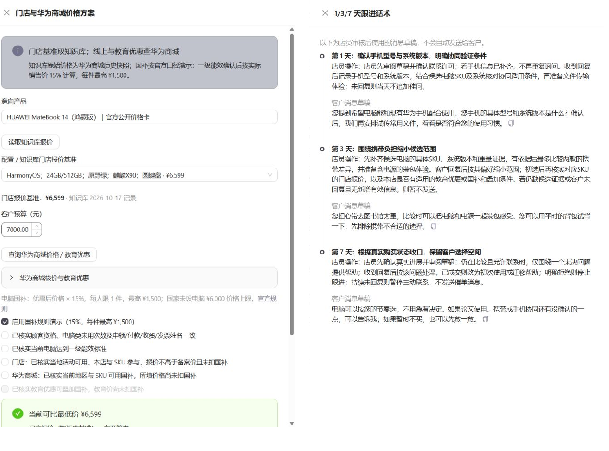
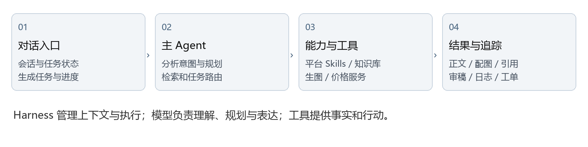

# PC Studio 项目说明书

深藏 blue 队 · 2026 年 10 月 23 日

华为 PC 门店营销工作台

深藏 blue 队  |  华为产业进阶赛道  |  2026 年 10 月 23 日

PC Studio 面向华为门店员工，把选产品、写图文、做配图、查依据和顾客跟进放进同一个工作台。员工可以从一句不完整的想法开始，由 Agent 引导补齐信息，产出适合目标平台的营销图文，并继续承接顾客咨询。

### 先看功能  再看优势

| 员工要做的事 | PC Studio 提供的功能 |
| --- | --- |

| 不知道写什么产品 | 根据人群和使用场景推荐候选，解释匹配理由 |

| 有产品但不会写软文 | 对话确认用途与平台，调用平台 Skills 策划和写作 |

| 缺少合适配图 | 生图子 Agent 基于官方产品素材生成场景配图 |

| 不熟悉产品或想核对事实 | 产品线速览、知识库查阅、正文引用角标跳转 |

| 顾客还在考虑 | 成交建议、配置价格参考、1／3／7 天跟进草稿与客户工单 |

### 回应一线真正关心的三件事

内容要吸引人，素材要对应真实产品，操作要足够简单。我们以营销图文创作为主线，用平台表达、生图协作和知识引用提升内容可用性；成交助手把内容之后的咨询与跟进接起来。

阅读导航：第 2—6 页介绍五项优势与实现；第 7—9 页展示三组真实图文案例；第 10—12 页说明自研架构、赛题回应及部署边界。

## 01  从一句想法开始创作

店员不必先把需求写完整。明确型号时，围绕已选产品展开；只有“出差办公”“开学购机”等场景时，先推荐候选并展示原因，再由员工选择。后续提问用于推进当前任务，已经确认的人群和型号应持续带入。

### 交互变化

| 任务起点 | Agent 应完成的动作 | 员工的下一步 |
| --- | --- | --- |

| 我想写 MateBook 14 的小红书 | 识别型号与平台；补充影响选题的关键信息 | 选择目标人群或补充用途 |

| 想给经常出差的人推荐电脑 | 拆解携带、阅读、会议等需求；检索产品特性 | 查看推荐理由并选择型号 |

| 这款可以，换成公众号 | 沿用已确认产品与受众，更新平台策略 | 查看重写结果并继续修改 |

### 实现方式

主 Agent 读取会话消息和已确认任务状态，先分析新输入，再判断信息缺口。规划模型选择追问、推荐、生成、修改或成交辅助等动作；需要确认时可返回选择项与补充输入。服务端保存消息、任务和产物，为同一会话续写提供上下文。

### 为什么比前置表单更省力

员工只需确认当前最关键的选择。已经在首句出现的“大学生”“出差办公”等信息应直接复用；不知道选哪款时，由 Agent 给出有资料支持的建议，避免把推荐责任重新交回员工。统一工作台界面见第 5 页图 3。

工程入口：taskAgent.cjs、llmClient.cjs、sessionStore.cjs。会话持久化已具备；长对话摘要质量、故障恢复后的状态一致性仍需要持续回归验证。

## 02  同一产品适配不同平台

平台 Skills 把“发到哪里”转化为具体写法。产品事实保持一致，内容角度、段落结构、语气、配图计划和行动引导随平台变化，减少员工拿到稿件后再手工改成平台风格的工作。

| 平台 | 表达重点 | 成品形态 |
| --- | --- | --- |

| 小红书 | 从读者熟悉的场景和选择纠结切入，表达具体偏好 | 短段落、自然 emoji、主题标签和轻互动 |

| 微信公众号 | 围绕一个观点展开，解释需求与产品特性的关系 | 连贯长段、论述层次和结尾讨论 |

| 朋友圈 | 聚焦一个值得分享的点，保留门店服务温度 | 简洁表达与自然咨询邀请 |

| 微博 | 突出可快速理解的主题与话题 | 紧凑正文与话题组织 |

| 抖音图文 | 按浏览顺序拆解信息 | 封面钩子、图卡节奏与配文 |

| 哔哩哔哩 | 展开选购思路与场景解释 | 分节说明与更充分的比较维度 |

### 规则如何进入生成

平台规则来自根目录 SKILL.md，copywritingSkill.cjs 和 platformStrategies.cjs 根据本次平台加载对应内容，并用于策划、写作与审稿。模型先决定选题角度、读者关注点与段落安排，再输出正文；图片计划也应承接该角度。

### 真实输出中的可见差别

小红书案例以“出差装包时，我会先看它有多重”为标题，末尾询问读者最在意重量、屏幕还是接口，并带主题标签。公众号案例则以“装进包里和落座之后都要想一想”为主张，沿赶路、阅读、会议连接逐段解释，且不带话题标签。两篇原文节选见第 7、8 页。

这两组记录的产品不同，只用于说明实际表达形态，不能作为控制变量的平台效果实验。下一步应固定型号、受众与目标进行跨平台盲评，重点检查开头、结构与语气是否真的不同。

### 让事实约束留在后台

不编造续航、价格或体验，是创作规则；正文用准确表述和引用角标承接依据，不机械堆叠“资料未提供”“实际受测量方法影响”等防御性话语。涉及具体版本和系统差异时保留必要条件，不虚构亲身长期使用经历。

## 03  生图子 Agent 协作完成配图

员工描述一次需求，主 Agent 就把已确认的产品、受众、平台、视觉要求与配图计划交给生图子 Agent。图片需要服务段落内容：封面建立产品识别，内文图回应携带、阅读、会议等场景。多张图通过场景、光线和构图形成变化。

### 当前实现的两条生图路径

| 路径 | 处理方式 | 控制重点 |
| --- | --- | --- |

| 官方原图参考编辑 | 把同型号官方图交给支持编辑的图片模型，替换或重构背景 | 提示保留产品形状、配色、接口与品牌标识；发布前人工复核 |

| 背景生成与主体合成 | 生成空场景背景；准备透明主体或执行抠图；再完成合成 | 用官方主体保持外观；检查边缘、透视和接触阴影 |

### 工程职责与失败处理

主流程负责检索和准备产品资料、素材与图文计划；子 Agent 负责素材处理、调用图片服务、合成或编辑、保存产物并回传图片元数据。接口预留使图片能力可以由独立成员维护，再接入统一任务。

图片数量受任务计划和后端上限共同限制。单张失败、超时或素材处理失败时，按已有回退逻辑使用官方素材并记录告警；请求多张不代表每张都生成成功。凭证与图片服务配置仅保留在后端。

实现位置：services/api/src/agent/imageAgent/。图 2 的会话记录模式为 ai_reference_edit，不将其描述为抠图合成结果。

## 04  学产品和查依据在同一处完成

门店员工既是内容作者，也是产品讲解者。PC Studio 将产品线速览、产品知识库和内容创作连接起来：先理解定位与适用任务，创作时调用资料，生成后点击正文角标回到对应知识库条目。

### 一条产品事实的使用路径

官方公开资料整理为本地知识条目 → 检索本次型号相关证据 → 模型用已获支持的事实写作 → 后端把证据标记转换为引用编号 → 员工点击角标查看对应产品知识库。

| 工作空间 | 员工得到的帮助 | 当前数据范围 |
| --- | --- | --- |

| 新品速递 | 快速了解产品线定位和适用任务 | 本地产品资料汇总；属于产品线重点速览 |

| 产品知识库 | 查看型号、版本、参数及来源 | 本地 v7 知识库，保留官方来源信息 |

| 客户工单 | 记录得到同意后的持续跟进事项 | 系统内已建立的工单 |

| 经营看板 | 查看已录入业务记录的汇总 | 系统内数据，不等于外部平台完整归因 |

后端 contentCitations.cjs 依据本次证据建立正文引用；前端 knowledgeNavigation.jsx 打开知识库条目。跳转目标由系统控制，减少让模型自由编造链接的风险。当前跳转到条目层级，不宣称已逐句高亮原始资料。

## 05  从顾客咨询延伸到成交跟进

同一对话入口也可以描述顾客预算、用途和顾虑，获得推荐依据、讲解话术、异议回应及第 1、3、7 天的跟进草稿。员工确认需要持续跟进后，再补齐工单信息，沉淀为客户工单。

### 真实成交辅助案例

输入摘要：顾客预算 6000—8000 元，经常出差，处理 PPT、Excel、视频会议和投影；担心公司软件、Excel 插件兼容，也在比较线上价格，希望下周前换机。顾客尚未留联系方式。

运行结果优先核对软件与插件条件，再安排具体配置、报价和交付验证。客户选择 MateBook 14（鸿蒙版）后，继续围绕该型号生成成交建议，而不是重新收集软文发布平台。

| 阶段 | 本次记录中的跟进重点 | 动作边界 |
| --- | --- | --- |

| 第 1 天 | 补齐必用软件和插件名称、版本 | 无联系方式或联系许可时，不主动触达 |

| 第 3 天 | 核对所选配置的官网参考价、门店报价与权益 | 对齐同型号、配置、系统与套装再比较 |

| 第 7 天 | 根据已购、仍在比较或暂不购买的状态收口 | 已购转使用帮助；拒绝或持续未回复则暂停 |

### 比价与跟进界面

价格服务按带日期与来源的官网公开快照筛选配置和预算；门店优惠组合由规则处理。跟进阶段框架由系统规定，具体文案结合客户顾虑生成，由店员审核后使用，不会自动发送。

案例记录：session_1792740427362_2d38ee。该记录已生成方案与跟进草稿；价格卡快照与文案对有效报价的判断仍存在口径不一致，不能据此承诺实时最低价或认定整个比价交互已通过回归。

## 06  案例一  出差办公的小红书图文

任务起点：员工只说明“想写一篇适合出差办公人群的软文，推荐几款便携的华为电脑”。在候选推荐后选择 HUAWEI MateBook 14 酷睿 Ultra，并确认小红书平台。

实际生成标题：出差装包时，我会先看它有多重

### 真实输出节选

出差前收包，文件、水杯、充电器一样样放进去，留给电脑的位置又紧了些。经常背着电脑赶路，我会先把随身重量放在前面。

从家门口到车站，再从车站转去酒店，电脑也要跟着一路挪地方。HUAWEI MateBook 14 酷睿 Ultra机身重量约1.31千克。[1] 对需要把电脑和其他物品一起背走的人，这个数字是把它放进出差候选名单的一个理由。

互动结尾：你出差选电脑时，最先考虑的是重量、屏幕还是接口？

### 本例说明了什么

从“没有明确型号”进入产品推荐再进入创作；正文把装包、赶路、查看方案和接屏等动作与产品特性联系起来，附知识库引用和主题标签。图片记录含多张参考编辑场景图，本页展示封面之一。

事实与图片来源：华为官网 MateBook 14 2024 产品页及对应本地产品事实条目。

运行依据：session_1792722870251_126c16；文本模型 gpt-5.6-sol。记录状态 warning；文本、事实与平台自动检查通过，无阻断项，图片仍待人工核验。以上为原文节选。

## 07  案例二  出差办公的公众号文章

任务起点同为出差办公场景，员工选择 HUAWEI MateBook D 14 2024，并把平台定为微信公众号。

实际生成标题：出差选电脑，装进包里和落座之后都要想一想

### 真实输出节选

行李箱里少带一件衣服很容易，电脑却很难落下。给经常出差的人选电脑，既要想到一路背着它的自己，也要想到抵达后打开文档、准备开会的那一刻。

出发前收拾背包，电脑、随行的文件和洗漱用品，一件件放进去。等到进站、换乘，再走到酒店，这只包会跟着你走过不少路。站在门店选机的那几分钟，值得把这些动作也一起想一遍。HUAWEI MateBook D 14 2024，就是可以沿着这趟行程来考虑的一款电脑。

### 本例说明了什么

文章沿“装包—落座阅读—会议连接”的逻辑展开，逐段解释重量、屏幕比例和 HDMI 与使用习惯的关系。与小红书案例相比，篇幅和论述更完整，结尾邀请讨论，不带主题标签；型号不同，不能直接归因于平台规则。

事实与图片来源：华为官网 MateBook D 14 2024 第 13 代酷睿产品页及对应本地产品事实条目。

运行依据：session_1792722861421_a8c81e；文本模型 gpt-5.6-sol。记录状态 warning；文本、事实与平台自动检查通过，无阻断项，图片仍待人工核验。以上为原文节选。

## 08  案例三  大学新生的开学购机内容

任务起点：为准备开学购机的大学新生生成小红书图文，考虑学习、携带与续航。最终记录对应 HUAWEI MateBook Pro S。

实际生成标题：新生买电脑，学习携带续航怎么选？

### 真实输出节选

课件要看，课本要背，连着上课还得考虑充电。开学第一台电脑，我建议先顺着自己的课表想一遍，再决定哪些特点最重要。

📚 如果你经常在教室看课件、去图书馆读长文档，HUAWEI MateBook Pro S 的屏幕值得放进比较范围。
14.2英寸柔性OLED屏，采用3:2比例、3120 × 2080分辨率，支持十点触控。对喜欢直接点按操作的新生，这是一个关注点。

### 本例说明了什么

已有输出按课件阅读、往返教室、充电安排组织，形成学习与携带的场景联系；图片记录同时含一张生成图与官方素材。历史正文仍有较多防御性说明，本例用于证明真实场景覆盖和发现改进点，不将其包装为最新风格规则的最佳成品。

事实与图片来源：华为官网 MateBook Pro S 产品页及对应本地产品事实条目。

运行依据：session_1792719464141_eb772a；文本模型 gpt-5.6-sol。记录状态 warning；文本、事实与平台自动检查通过，无阻断项，图片仍待人工核验。以上为原文节选。

## 09  自研 Agent 如何支撑产品体验

PC Studio 的自研部分是面向门店营销业务的 Agent 编排与运行环境。底层文本和图片模型通过服务接口调用；我们围绕业务设计任务状态、上下文、工具、平台 Skills、子 Agent 协作、核验与失败追踪。

| 层次 | 工程职责 | 对应产品价值 |
| --- | --- | --- |

| 会话与任务状态 | 保存消息、已确认字段、产物与请求关联 | 让修改和追问沿用同一任务 |

| 主 Agent | 识别创作与成交意图，规划下一步，组织检索和审稿 | 从不完整需求推进到可交付结果 |

| 平台 Skills | 平台策略与表达规则注入策划、写作和审稿 | 减少通用模板腔与平台混同 |

| 知识与价格工具 | 检索本地产品依据，组织官网资料及价格快照 | 推荐和正文有据可查 |

| 生图子 Agent | 按图文计划调用图片模型并保存结果 | 把找图和场景配图纳入统一流程 |

| 作业与日志 | 任务状态、阶段进度、失败记录与请求标识 | 多会话任务可追踪，失败可定位 |

### 规范落在不同层

系统提示词决定模型如何理解和规划，SKILL.md 与平台策略规定表达方式，编排代码决定可执行动作与状态变化，验证代码检查输出结构、证据和引用。规则文件需要被运行时代码加载才会影响业务；单独新增 AGENTS.md 并不能替代这些执行机制。

### 追踪一条失败请求

会话记录位于 data/sessions，生成任务记录位于 data/generation-jobs，运行日志位于 data/run-logs。结合会话 ID 和请求标识查看失败阶段、上游状态和模型调用记录，可区分鉴权、额度、超时、结构解析、内容核验与图片处理失败。

这些机制构成当前 harness：管理模型的上下文、执行、工具与结果。上下文压缩、恢复质量和长期经验学习仍需专项评测，不将持久化聊天记录等同于自动学习。

## 10  对照赛题要求的产品回应

主办方初赛反馈强调：素材对应真实产品、内容吸引人、操作简单并减少门店员工工作量。说明书以这三点组织产品价值，成交辅助作为图文创作之后的业务延伸。

| 手册评分维度 | 分值 | 项目回应与本说明书证据 |
| --- | --- | --- |

| 业务场景理解 | 20 | 明确型号与场景推荐两种起点；第 2、7—9 页 |

| 产品事实准确性 | 20 | 按型号检索、证据引用、知识库回查；第 5、10 页 |

| 图文生成与图片引用 | 15 | 生图子 Agent、来源与真实配图；第 4、7—9 页 |

| 平台适配与软文质量 | 15 | 平台 Skills 及小红书、公众号输出；第 3、7—8 页 |

| 自研 Agent 与提示词 | 15 | 主 Agent、任务规划、Skills 与工具编排；第 10 页 |

| 完成度与用户体验 | 10 | 统一入口、历史会话、工作空间与跟进；第 2、5—6 页 |

| 合规与安全 | 5 | 来源、价格时效、人工审核、凭证服务端配置；第 12 页 |

### 真实案例覆盖与验证口径

本说明书提供三组已保存的图文产物，覆盖出差办公与开学购机两类场景、小红书与公众号两个平台，另补一组成交辅助。三组记录的型号、事实、平台、合规检查均为 pass，模型审稿通过，无阻断项；总体 warning 来自本地快照与图片待人工核验。自动检查结果不等于人工评测准确率或真实传播效果。

本次工作核对文档、代码和历史产物，并检查说明书排版；没有重新发起付费模型调用，也没有重跑完整业务验收。现有截图均标明测试来源或局部范围，不把历史测试界面宣称为当前版本的逐项验收。

### 资料来源与赛题口径

当前运行以本地华为 PC v7 知识库为静态事实来源，结合华为官方素材和 VMall 信息，运行时不依赖 ima 云检索。手册 v4 对 ima 及图片来源有原始评分约定，后续反馈鼓励自主生图等创新；提交材料应明确这一区别，由主办方确认最终适用口径。

依据：赛题手册 v4 第 2—5 页的作品与平台要求、第 8 页的案例要求、第 9 页的评分项；以及主办方初赛反馈。

## 11  部署使用与当前边界

### 本地启动

运行环境为 Node.js。首次启动分别安装 services/api 和 apps/web 的依赖；后端需要配置文本模型与图片服务，再打开前端工作台。以下命令在项目根目录执行。

| 顺序 | 命令或操作 |
| --- | --- |

| 1 安装后端依赖 | npm --prefix services/api install |

| 2 安装前端依赖 | npm --prefix apps/web install |

| 3 配置服务端 | 按 .env 示例与生图接入文档配置模型、接口地址、凭证和图片上限 |

| 4 启动 API | node scripts/start-api.cjs |

| 5 启动前端 | npm --prefix apps/web run dev -- --host 127.0.0.1 --port 5173 |

| 6 打开工作台 | 浏览器访问 http://127.0.0.1:5173/ |

### 建议演示路径

新建对话，输入一个场景 → 查看候选与推荐依据 → 选定型号和平台 → 查看正文与场景配图 → 点击事实角标查看知识库 → 在同一入口描述客户咨询 → 查看成交方案和 1／3／7 天草稿 → 按需建立工单。

### 已知边界与下一步

内容质量：以固定任务对照评测平台差异、自然度与可发布性；把第 9 页的防御性话语作为回归样例，验证风格规则在成品中生效。

事实与价格：资料有抓取日期和版本差异；动态报价、库存和权益以具体 SKU 的最新官方信息及门店确认为准。需统一价格卡与生成话术的证据状态。

图片与稳定性：参考编辑可能改变外观或添加多余文字，发布前需审核；多图保留进度、超时与回退。“选这款继续比价”应列入发布前交互回归。

数据与安全：凭证仅在后端，不进入截图和仓库；客户工单在确认联系意愿后录入必要信息；日志避免保留敏感凭证与无关个人资料。跟进草稿由员工审核发送。
